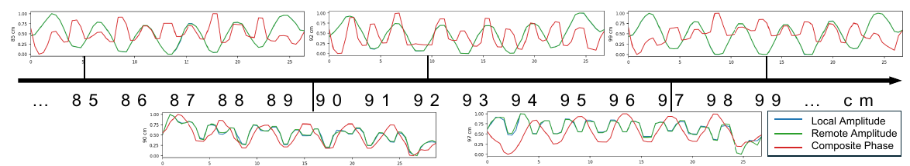
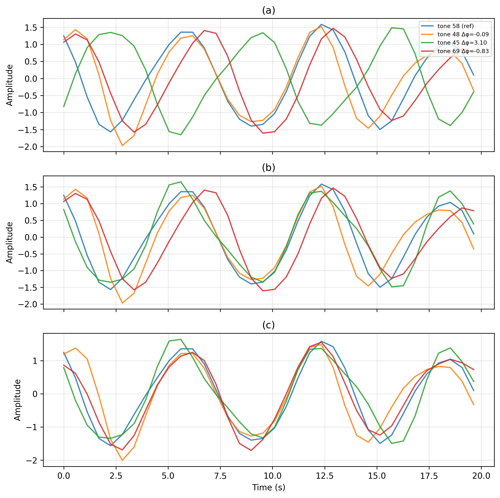

# BreatheCS: Spectral Fusion and Coherent Waveform Reconstruction for Respiration Sensing with Bluetooth Channel Sounding

# BreatheCS：融合双向 BLE 信道探测测量的非接触式呼吸感知——频谱融合与相干波形重建

记录：第二版重构：正文改动

## Abstract / 摘要

 Wireless sensing with commodity communication devices has attracted considerable attention because of its contactless operation and low deployment cost. Despite its widespread adoption, Bluetooth has played a limited role in this field, largely because fine-grained sensing measurements have not been readily accessible. The introduction of Channel Sounding (CS) in Bluetooth Core 6.0 provides new opportunities for wireless sensing. However, CS was developed for ranging rather than sensing, and the extent to which its protocol characteristics and measurement structure support sensing tasks remains insufficiently understood. This paper uses respiration monitoring as a representative task to systematically investigate the sensing capabilities of BLE CS through theoretical modeling and experimental validation. We further propose BreatheCS, a respiration sensing framework tailored to the characteristics of CS measurements to effectively exploit the available observations. Experiments on recordings from eight participants demonstrate that measurements obtained through the standardized Bluetooth Core 6.0 CS interface support contactless respiration sensing. Compared with representative methods adapted from recent wireless sensing studies, BreatheCS achieves the lowest errors in both respiratory-rate estimation and waveform reconstruction, with a mean absolute error of 0.371 breaths/min and a normalized waveform root-mean-square error (RMSE) of 0.937, respectively. These results demonstrate the potential of Bluetooth CS for wireless sensing, with additional practical advantages arising from its low deployment cost and compatibility with CS-capable commodity devices.

基于商用设备的无线感知具有非接触式、部署成本低等优势，已得到了相当的关注。尽管蓝牙应用广泛，却因为长期缺乏可用的感知信息而几乎缺席这一领域。蓝牙在6.0版本推出了信道探测这一新测距技术，同样为无线感知的研究带来了极大的便利。但信道探测是测距技术，并非专为感知而设计，因此其规范特性、信息特征等在多大程度上可用于感知，尚缺乏严谨的探讨。本文以呼吸监测作为典型感知任务，通过理论建模和实验验证，对信道探测这一测距技术在感知任务上的性能给予严谨的实验评估。进一步地，本文针对信道探测的特性提出 BreathCS，以充分利用可用的测量信息。我们在8个实验对象的数据上所进行的实验结果表明，基于 6.0版本接口的信道探测，其测量数据完全可用于呼吸感知。同时，所提出的BreathCS 在与无线感知领域的近期相关工作的比较中也取得了最低的误差，对于呼吸频率和呼吸波形的最佳误差分别为 0.371 BPM 与0.937的 RMSE。结果进一步表明，蓝牙信道探测在无线感知领域具有相当的潜力，此外，当考虑部署成本与商用设备兼容性时，蓝牙则具备更大的优势。

## 1. Introduction / 引言

### 1.1 问题与应用价值

呼吸是睡眠监测、慢病管理和呼吸异常早期检测的基础生理指标。传统监测方案通常需要穿戴式绑带、电极或专用雷达硬件\cite{yang2022artificial}。尽管这些方法得到了充分的应用，但这些方案通常需要专门的硬件平台以及专业的佩戴，这使得长期和普适性部署具备挑战性。

使用商用通信设备的无线信号作为感知手段因此成为一种有吸引力的替代方案。复用商用设备意味着不需要额外部署传感器，无线感知也解决了必须佩戴传感器这一局限。近年来，基于WIFI \cite{zhang2024wi}，LoRa \cite{zhang2020exploring}等商用设备的感知工作已经得到充分的探索。然而，这些感知方案仍然需要改造商用设备提取细粒度感知信息，支持这种改造手段的型号较少。另一个无法忽略的问题是，在潜在的居家监测等室内场景中，感知设备往往无法像实验室里按最理想的方式布置。如果能进一步拓展可用的感知手段，将有助于拓展感知的边界。在各类潜在候选技术中，BLE 设备种类丰富，广泛应用于智能手机、可穿戴设备、嵌入式设备和物联网系统中，具有极大的潜在应用价值。

### 1.2 为什么 BLE Channel Sounding 值得研究？

在过去， BLE 仅提供接收信号强度指示（RSSI）等粗略测量，一些前期研究已经表明BLE的感知能力有限【iannizzotto2022perspective】。蓝牙核心规范 6.0 \cite{bluetooth6}中引入的信道探测（CS）改变了这一局面。信道探测是一种无线测距技术，旨在利用基于相位的测距（PBR）和往返时间测量（RTT）实现两个设备的距离测量\cite{bluetooth_channel_sounding}。尽管CS不是为感知而设计，但它首次为BLE引入了两个实现细粒度感知的重要信息：1）精细的信道信息测量，BLE 6.0设备可以直接测量接收信号的幅值相位；2）可控的信道多信道选择：CS 在多达 72 个信道上实现单独测量，这一点避开了蓝牙跳频技术对感知的影响。这意味着，使用者可以利用CS追踪特定信道上的感知活动，例如呼吸监测。

尽管CS为BLE无线感知创造了新的机会\cite{wang2025exploration，paulikas2026exploring}，但我们发现，CS 的测量结构与感知需求并不直接适配。由于技术特性仅考虑了测距需求，它的设计更注重安全性和精度。首先，CS 需要双向的相位校正项（PCT）测量才能确定信道的相位变化，但感知并不一定必须使用相位信息。其次，如果需要得到可用的相位信息，在6.0标准下，这需要通过BLE应用层的测距服务实现测量数据的传递。这两个因素共同拖慢了更新率。但一个不可忽略的优势是，CS为BLE带来了目前已知的基于商用通信设备的无线感知方法中唯一的标准数据接口。获取BLE CS的感知信息不需要对设备进行任何改造，也不涉及BLE规范之外的私有接口。

### 1.3 我们的方案和贡献

为了探索CS在感知上的应用潜力，我们以呼吸感知作为代表性任务，提出了 BreatheCS，这是一个专为 BLE CS定制的呼吸感知框架。BreatheCS从双向信道测量中提取对呼吸敏感的时序数据，并联合利用幅值和相位模态。此外，它还考虑了各个信道和模态之间的质量，进而提出一种自适应的融合方法。BreatheCS 的一项关键设计是将呼吸频率估计与波形恢复独立处理【图：fig:overview】。对于呼吸频率估计，BreatheCS 在谱域中执行信道间质量加权聚合，然后一句呼吸能量比作自适应的融合。对于呼吸波形恢复，则通过信道的时域对齐与相干融合，最大程度地利用所有可用信息实现波形重建。

我们使用来自八名参与者在三种室内场景下的 24 条人体记录对 BreatheCS 进行评估，并与近期的相关代表性工作做对比。BreatheCS 在呼吸频率估计的误差为0.371BPM，呼吸波形重建的均方根误差（RMSE）为0.937，取得了最佳的结果。实验结果同时表明，CS的多信道测量能有效提升呼吸感知结果的鲁棒性。同时，虽然相位信息在一些感知方案中具备优势，但在CS中，相位观测的呼吸活动没有幅值鲁棒。

本文的贡献如下：

1. **BLE CS 呼吸观测建模与实证刻画。** 我们将双向 PCT 测量表述为两个端侧幅度观测和一个复合相位观测，并刻画它们的呼吸敏感性以及信道间关系。
2. **任务专用、可靠性感知的融合。** 我们提出 BreatheCS：为呼吸频率估计和波形重建设计具有差异化的融合策略，以解决稀疏采样、依赖多径的偏移以及异构信道可靠性问题。
3. **BLE CS 感知的实验表征。**我们通过实验表明，频率信道分集为呼吸监测提供了主要且最一致的增益，而相位信息通常不如幅值信息更鲁棒。

本文其余部分组织如下：第二节回顾相关工作；第三节介绍 BLE 信道探测；第四节提出呼吸观测模型；第五节描述 BreatheCS；第六节报告评估结果；第七节总结全文。

## 2. Related Work

### \subsection{基于商用通信设备的射频呼吸感知}

射频呼吸感知通过测量呼吸引起的无线传播变化，在无需被监测者佩戴传感器的情况下获取呼吸信息。超宽带雷达和调频连续波雷达等专用雷达系统已经验证了非接触式生命体征监测的可行性 \cite{shyu18detection,yao24non}。另一条研究路线是复用通信信号和通信设备实现感知。已有研究利用 Wi-Fi \cite{zhang24wi,wang16human,wang17phasebeat,zeng19farsense} 和 LoRa \cite{zhang20exploring} 进行呼吸监测，表明商用通信技术能够为微弱生理运动提供可用的观测。这些研究为进一步探索基于蓝牙信道探测（Channel Sounding，CS）的呼吸感知奠定了基础。

基于通信信号的呼吸感知面临的一个核心问题是信道观测量的选择和处理。与接收信号强度指示值（RSSI）相比，Wi-Fi 信道状态信息（CSI）能够提供不同子载波上更细粒度的幅度和相位测量。早期研究证明了从 CSI 变化中提取呼吸运动的可行性 \cite{wang16human}，后续研究则通过不同的信号表示提高感知灵敏度和鲁棒性。例如，PhaseBeat 利用不同接收天线间的 CSI 相位差进行生命体征监测 \cite{wang17phasebeat}，FarSense 则利用不同接收天线间的 CSI 比值模型改善呼吸感知，提高感知精度并扩展感知距离 \cite{zeng19farsense}。这些方法表明，一种测量是否适合感知，不仅取决于能否获取该测量，还取决于如何处理硬件引入的扰动，以及与运动相关的信道响应。

不同感知平台在测量信息的获取方式上也存在差异。传统的基于 CSI 的 Wi-Fi 感知系统通常依赖受支持的网络接口和相应的提取工具，而基于波束成形反馈的方法提供了另一条获取信道相关信息的路径 \cite{yi24bfmsense}。BLE CS 则通过标准化的探测流程和控制器测量上报机制提供了不同的测量接口 \cite{bluetoothsig24bluetooth,woolley24bluetooth,bluetoothsig25bluetooth}。然而，测量接口的可用并不意味着现有感知方法可以直接应用于基于 BLE CS 的感知。BLE 和 CS 具有不同于常见 Wi-Fi CSI 平台的特点：对于许多面向低成本、低功耗应用的 BLE 设备，天线阵列并非默认配置，引入阵列会增加硬件成本和复杂度；同时，双向 CS 测量的观测结构也是 BLE CS 感知需要专门考虑的特性。因此，本文研究 BLE CS 能够提供哪些呼吸观测量，以及这些观测量之间的关系应当如何指导信号处理环节。

### \subsection{基于蓝牙的无设备感知}

基于蓝牙的人体感知逐步从粗粒度的信号强度测量（RSSI）发展到更细粒度的观测。早期 BLE 感知主要利用 RSSI 的变化，实现人员占用检测和运动相关感知等任务 \cite{iannizzotto22perspective,huang19robust}。虽然许多设备能够直接提供这类测量，但其有限的测量粒度，以及随工作频率变化的信号响应，使微弱呼吸运动的观测更加困难。随后，蓝牙测向（Direction Finding，DF）功能引入了用于方向相关测量的同相与正交（IQ）采样 \cite{woolley19bluetooth}。研究人员进一步将这一能力用于无设备手势识别和运动感知 \cite{zhang23bleselect,taniguchi24device}。这些工作表明，蓝牙测量不仅能够用于无线定位，也具有其他感知价值。不过，基于到达角或出发角的蓝牙测向需要至少一端配备天线阵列，这限制了其在单天线设备上的适用性。

蓝牙 CS 通过支持跨多个频率信道的双向测量，为无线感知提供了新的机会 \cite{bluetoothsig24bluetooth,woolley24bluetooth}。CS 允许两个设备通过单天线的双向测量实现高精度测距。在标准 CS 推出之前，已有研究探索了 BLE 的高精度相位测距 \cite{zand19high}；相关的相位测距与 CS 研究进一步讨论了多径效应、距离估计方法以及测距性能等问题 \cite{schroder19investigation,santra24enhancing,tsemko25data,debuyst24multipath,wieme25performance}。这些研究建立了重要的测量与处理基础，但其主要目标是估计参与测量的设备之间的距离。无设备呼吸感知则面临不同的问题：需要从包含强静态分量和环境多径的传播信道中，恢复呼吸引起的微弱扰动。此外，呼吸感知通常需要持续采样，并对采样时序的规则性提出要求，而单次距离估计并不必然具有相同要求。

近期研究开始探索蓝牙呼吸监测 \cite{tian23bluebreathe}，以及基于 BLE CS 的无设备感知 \cite{wang25exploration,paulikas26exploring}。Wang 等人的研究 \cite{wang25exploration} 初步展示了 CS 距离序列用于活动识别的价值，但未进一步展开对双向测量结构的分析。随后，Paulikas 和 Paulikienė 从 BLE CS 得到的距离估计中提取时间特征，用于跌倒检测 \cite{paulikas26exploring}，但并未讨论原始的幅度和相位观测量。上述两项 CS 感知工作尚未针对本文关注的呼吸观测量开展细致的理论建模和性能评估。本文关注的是建立端点幅度、复合相位与呼吸运动之间的联系，刻画这些观测量随信道变化的响应，并将其用于呼吸率估计和波形重建。

### \subsection{多信道融合与呼吸波形重建}

由于不同信道对同一运动的灵敏度可能存在显著差异，信道多样性被广泛用于改善无线呼吸感知。近年的代表性方法包括基于质量的信道选择、主成分分析（PCA）以及最大比合并（MRC）等加权组合方法。例如，ClessBreath \cite{fan24contactless} 评估呼吸相关能量的集中程度，并将其用于信道组合和观测选择。Position-free \cite{zhuo23position} 采用基于 PCA 的处理方法，WiFi-Sleep \cite{yu21wifi} 则在睡眠监测中引入最大比合并与 PCA 相关处理。这些研究为从含噪且质量不一致的测量中提取共同呼吸分量提供了有效思路。

然而，呼吸率估计与波形重建对观测组合提出了不同要求。由于恒定的波形相位偏移不会改变相应频率分量的功率，功率谱可以在不预先对齐呼吸波形相位的情况下进行聚合。相比之下，直接组合相位不一致的时域波形，可能削弱目标分量，甚至导致相互抵消 \cite{fan24contactless}。利用 PCA 处理波形的同相与反相关系，并结合加权组合，为波形融合提供了有用的基础方法 \cite{zeng18fullbreathe}，但其适用性需要结合目标平台的波形关系与测量条件进行考虑。对于 BLE CS，这些条件包括双向观测结构，以及本文实现中较低的有效更新速率。

观测融合还需要正确区分互补信息和不可靠测量。以 FarSense \cite{zeng19farsense} 和 Position-free \cite{zhuo23position} 为代表的多天线 CSI 比值方法，可以在 IQ 平面上寻找突出呼吸运动的投影方向，直接从复数表示中提取有效波形，而不必分别处理幅度和相位。然而，这类处理依赖特定的多天线 CSI 比值表示；BLE CS 的双端幅度和复合相位并不构成相同的输入表示，因此相关方法不能不加修改地直接迁移。此外，能够获取多个观测量，并不意味着它们都应当始终参与最终输出。因此，BreatheCS 在共享质量评估的基础上采用面向不同任务的处理方式：频谱分支聚合信道频谱，并在端点幅度候选与复合相位候选之间进行选择；波形分支则在信道融合和端点幅度融合之前对齐呼吸波形的相位，随后进行候选选择。通过这些针对性的设计，BreatheCS 利用 BLE CS 提供的可用观测，使信号处理流程与其测量特性相适配。

## 3. Preliminaries / BLE CS 基础

### 3.1 Channel Sounding Measurements / BLE CS 物理基础

BLE 6.0 推出了信道探测功能，它为BLE引入了两种测距方式的正式支持。一种是测量收发时间差的RTT，另一种则是测量信号相位偏转的基于相位的测距（phase-based ranging, PBR）。PBR是信道探测的主推测量方式，相比RTT，PBR的精度更高，也更稳定。

在规范里，CS -PBR （以下简称CS）要求两个设备必须首先连接，因为需要确定发起者、接收者的角色。随后，在BLE的频段上以1MHz 的带宽为步进依次执行每个信道的测量。在预留一部分信道后，实际启用的信道数为72个。

在每个信道测量中，双方各自向对方发送一个 CS tone，并由接收方测量该 CS tone 的幅值和相位，以 IQ 形式存储，记为 PCT （即 phase correlation term）。双方的PCT 在当前event 结束后会经由 ranging service 收集到一处。

为了抵消两个设备间的本振漂移，将两端 PCT 做复数乘法，使其相位相加、LO 漂移项抵消，就能获得有物理意义的合成相位。我们设两个设备本振的固定相位差为  
$$
\Delta \theta_{LO} = 2\pi F(\varphi_i- \varphi_r),
$$
其中，$F$ 是当前信道频率， $\varphi_i,\varphi_r$分别是发起方、反射方设备对真实时间的延迟。

从发起方出发的CStone ，经过时间 $\tau$后抵达反射方。当我们以发起方作为最终PCT整合方时，反射方就被视为 remote 端。因此，这一过程中的相位变化由反射方记录为 Remote PCT:
$$
\text{PCT}_{\text{Remote}}:\theta_{INI \rarr REF}  = 2\pi F \tau +\Delta \theta_{LO}.
$$

然后交换角色，反射方向发起方发送 CS tone，发起方记录 Local PCT:
$$
\text{PCT}_{\text{Local}}:\theta_{REF \rarr INI} = 2\pi F \tau -\Delta \theta_{LO} .
$$
显然，若将两端 PCT 做复数乘法，相位相加后即可消去未知的 $\Delta\theta_{LO}$。二者均为(a+bi)形式的复数，使用复数乘法就能得到两者的相位之和。最后，我们所获得的可用物理层感知信息就是本地、远端PCT的幅值，以及PCT叠加后的相位（composite phase合成相位），我们分别将其记为：
$$
A_{\text{Local}},A_{\text{Remote}},\Phi
$$
由复数乘法获得的乘积的幅值就是幅值的乘积，并未引入新的物理量，因此本文对其不做单独讨论。

### 3.2 Sampling Rate and Its Implications / 有效采样率及其影响

尽管CS是专为测距设计的功能，它仍然需要遵循BLE 的基本通信规范。和其他应用层的功能类似，CS 仍然要在BLE 流程-事件-子事件 的框架内工作。一个CS流程可能包含多个CS事件，CS事件是包含所有必须步骤的最小测量单位。单个事件内包含多个step，每个step就是某个信道的一次完整的双向测量。 单个Step的耗时约300us，启用全部的信道后，单个事件的时长约为21ms。但根据BLE6.0规范\cite{bluetooth6}，远端的PCT需要经由 ranging service 返回，这需要占用更多的时间。我们在nordic nrf54L15 上进行了多次测试，发现最短的事件间隔约为250ms。但如果需要长期执行测量，需要适当放宽最大间隔的上限。因此，实际的事件间隔在 250-500ms之间，频率为2-4Hz。根据奈奎斯特采样定理，这恰好高于常见呼吸频率的2倍范围，因此可以实现呼吸频率估计。

## 4. Respiratory Observation Model / 呼吸观测模型

本节建立用于解释基于 BLE CS 呼吸感知的观测模型。我们首先分析BLE CS的有效物理观测量；接着，我们尝试构建信道、观测量模态之间的呼吸波形关系，以指导如何融合这些呼吸波形，达到提升信噪比、更好地拟合原始呼吸波形的目标。为此，我们讨论同一模态内 CS 信道之间的关系，并分析顺序 CS 信道扫描是否会引入不可忽略的呼吸相位偏移。最后，我们将模型扩展为多有效成分相量表示，从而解释不同观测模态间的连续性相位偏差，以为所提出的两级相干融合方法提供动机。

### 4.1 Usable Observables / 有效观测变量

在 Section 3.1 中，我们论证了单次CS 测量可获得的变量。在呼吸感知中，我们需要持续进行CS测量，以获得各个变量的时序数据，随后用于进一步提取呼吸。

对于每个 CS 信道 $i$，BLE CS 提供两个 PCT 复数观测：
$$
Z_{l,i}(t), \quad Z_{r,i}(t), \tag{1}
$$
其中 $Z_{l,i}(t)$ 和 $Z_{r,i}(t)$ 分别表示$\text{PCT}_{\text{Local},}$, $\text{PCT}_{\text{Remote}}$ 在时间$t$ 上的采样序列。

随后，我们计算得到三个可用的呼吸感知变量序列：
$$
A_{l,i}(t)=|Z_{l,i}(t)|, \qquad A_{r,i}(t)=|Z_{r,i}(t)|, \\\Phi_i(t)=\operatorname{unwrap} \left( \angle\left(Z_{l,i}(t)Z_{r,i}(t)\right) \right). \tag{2}
$$
其中，$A_{l,i}(t)$ 和 $A_{r,i}(t)$ 是幅度型观测，分别是来自两端设备对环境的观测；而 $\Phi_i(t)$ 是相位型观测。三者具有不同的物理意义。为了论证这一点，考虑一种简单的单一呼吸路径下的情形：
$$
Z_{d,i}(t)=\overline{Z}_{d,i}+\delta Z_{d,i}(t), \quad d\in\{l,r\},\tag{3}
$$
其中 $\overline{Z}_{d,i}$ 是准静态分量，$\delta Z_{d,i}(t)$ 是由呼吸引起的扰动，$d,l,r$ 分别表示两端设备、本地设备和远端设备。

当 $|\delta Z_{d,i}(t)|\ll |\overline{Z}_{d,i}|$ 时，归一化幅度扰动近似为扰动在工作点方向上的实投影：
$$
\frac{\delta A_{d,i}(t)}{\overline{A}_{d,i}} \approx \operatorname{Re} \left\{ \frac{\delta Z_{d,i}(t)}{\overline{Z}_{d,i}} \right\},\tag{4}
$$
其中 $\overline{A}_{d,i}=|\overline{Z}_{d,i}|$。相反，积分相位扰动近似为两端扰动的虚投影之和：
$$
\delta \Phi_i(t) \approx \operatorname{Im} \left\{ \frac{\delta Z_{l,i}(t)}{\overline{Z}_{l,i}} + \frac{\delta Z_{r,i}(t)}{\overline{Z}_{r,i}} \right\}.\tag{5}
$$
因此，幅度变量反映复数扰动在径向的投影，而积分相位反映两端切向投影之和。这一区别促使我们将本地幅度、远端幅度和合成相位视为高度关联但具备不同视角的呼吸观测模态。

### 4.2 单一呼吸运动下的CS波形

本章节用金属板模拟人体胸腔的位移，以观察本地幅值、远端幅值与合成相位是否具备感知呼吸位移的能力，并确认4.1节中对三种观测模态的关系的推论。

首先，考虑一种单一路径的边界情形：呼吸诱导扰动由单一有效位移成分主导：
$$
\xi(t)=X\cos(\omega_b t+\psi),
$$
其中 $X$ $\psi$ 分别表示位移幅度和初始相位，$\omega_b$  表示呼吸运动b 的角频率。

假设在工作点附近，本地和远端 PCT 扰动由该位移线性驱动：
$$
\delta Z_{d,i}(t)=V_{d,i}\xi(t), \quad d\in\{l,r\}.
$$

定义归一化复数灵敏度：
$$
\frac{V_{d,i}}{\overline{Z}_{d,i}} = u_{d,i}+jv_{d,i},
$$
其中 $u_{d,i}$ 和 $v_{d,i}$ 分别为实值径向和切向灵敏度系数。

则三个呼吸观测可写为：
$$
y_{l,i}(t)=u_{l,i}\xi(t),y_{r,i}(t)=u_{r,i}\xi(t),\\
y_{\phi,i}(t)=\left(v_{l,i}+v_{r,i}\right)\xi(t).
$$
为简洁起见，定义：$k_{l,i}=u_{l,i},\quad k_{r,i}=u_{r,i},\quad k_{\phi,i}=v_{l,i}+v_{r,i}.$

则每个观测可写为：
$$
y_{m,i}(t)=k_{m,i}X\cos(\omega_b t+\psi).
$$
等价地，其中幅值$A_{m,i}=|k_{m,i}|X,$ 则相位$\varphi_{m,i}$的偏差只和幅值 $A_{m,i}$ 的系数相关：
$$
\varphi_{m,i}= \begin{cases} \psi, & k_{m,i}>0,\\ \psi+\pi, & k_{m,i}<0. \end{cases}
$$

如果 $|k_{m,i}|\approx 0$，相应观测中包含的呼吸能量很少，其估计相位也会变得不可靠。因此，在单一有效成分和一阶扰动模型下，不同模态或信道之间的呼吸波形只能表现为同相、反相或弱响应。在这一边界情形中，二值符号校正在理论上已经足够。

#### 实验设置：

我们用实验验证BLE CS 的观测量中是否符合上述现象。我们在一个5m宽的空旷的长走廊上搭建了BLE CS 呼吸感知验证平台【图-金属板设置】，以讨论CS各个观测变量。BLE CS 的部署平台是 Nordic nrf54L15 ，这是一款已经上市并支持BLE 6.0 的物联网低功耗蓝牙芯片。我们使用原厂的 nrf54L15 DK （development kit）连接6dBi 的外置天线，然后将平台按间隔1m架设，并保证高度与金属板平齐。用于模拟人体胸腔的金属板尺寸为30*30cm。

我们令一侧作为BLE CS发起方（initiator），另一侧作为接收方。双方数据由发起方汇总，随后通过串口上传到笔记本电脑。我们还需要配置BLE CS 的一些参数，以确保测量频率和信道启用符合我们的预期。具体包括：启用所有信道（72个），测量间隔设置为250-500ms区间。其中，250ms是我们经过多次测试后，BLE CS 在当前6.0版本能够实现的最短间隔。同时，我们在实验中发现，250ms 间隔在长期测量时容易同步失败，导致CS测距中断，因此将最大间隔设置为500ms，以允许偶然超时情况。

在实验中，金属板会周期性前后移动，范围为1cm。金属板初始位置距离BLE CS设备的视距连接（LoS）为100cm，每执行完6次呼吸往复位移，金属板在滑台上前进1cm，然后再次执行6次呼吸往复位移。通过这种方式，我们将观察到随着金属板的位置不断移动，双端幅值和合成相位的呼吸波形出现相应的变化。

#### 实验结果：

- 往复运动在同信道不同模态上的差异
 

我们任意选定一个信道来展示三个模态的波形差异，并将不同位置处的波形予以比较。从【图-amp_pha_complement】我们观察到，随着金属板在滑台的不同位置上执行往复运动，各个模态上所观测到的波形呈周期性变化，且具备明显的交替互补特性。由于幅值和合成相位是PCT在径向和切向的投影，金属板建立的多径变化在两者上总有一处可以观测。两种模态的波形低显著区间是交替出现的，这证明它们代表着不同的视角。

- 信道的选择性衰落

我们在ch 20\40\60三个信道上比较呼吸波形的形态，且选择了86/87/88 三个位置处的幅值记录。由图【图-channel_position_matrix 】可见，随着位置改变，信道表现也不一致。在88cm 处，三个信道的表现都较好，前移 1cm 至87cm 后，ch 40 的呼吸不再明显；再前移1cm，ch 60 的波形出现失真/伪峰，而另外两个信道则波形清晰。这说明 CS PCT 的幅值变化与所处信道相关，信道不同，频率就不同，波形的表现也会有细微差异。

进一步地，我们比较同一位置、同一模态下，所有信道上的波形差异。由图【fig:phase_on_diff_channel】可见，一些信道的波形是同相的，一些则是反相的。

- 同一信道的三种观测量偏差不是整数 pi 

但不同的模态之间并不是只有同相/反相的差异，而是有处于0-pi 之间的相位偏移。我们追踪了不同信道在所有位置处的模态间相位差的变化，【图-position_sweep_figD2_dphi_vs_position_ch20_40_60】显示，大多数情况下，两端幅值基本同相，幅值和相位之间则基本是同相、反相的关系。但值得注意的是，在一些不同的位置，幅值间的相位差不再几乎为0，相位和幅值之间的偏移也不是整数 pi 。这些结果表明，BLE CS 的各个观测量之间存在随机的连续偏移。

- 人体活动和金属板的表现存在差异

我们请来四位 subject ，令其坐在远离 LOS 的固定位置处，距离以其胸腔为准。同时，我们要求他们跟随节拍器呼吸，频率与金属板的设定值一致。我们随后在相同的距离处再次测量金属板的呼吸，并比较波形的差异。为了评价两种波形，我们引入呼吸感知工作中两种广泛应用的评价指标：呼吸能量比$\eta$ 和波形的谱峰突出度$\rho$ （spectral peak prominence）来评价波形的质量。$\eta$ 在高通滤波后的信号上计算（衡量呼吸频段能量在总频谱中的集中程度），$\rho$ 在呼吸带通滤波后的信号上计算。记模态 $m$、信道$i$ 的波形高通后的功率谱为 $P_{m,i}^{\text{hp}}(f)$ ，带通后的功率谱 $P_{m,i}(f)$ ， $\mathcal{F}_b$ 为呼吸频段，$\mathcal{F}$ 为当前信号的有效频段。 $\eta$ 和 $\rho$ 定义为：
$$
\eta_{m,i}
=
\frac{\sum_{f\in\mathcal{F}_b}P_{m,i}^{\text{hp}}(f)}{\sum_{f\in\mathcal{F}}P_{m,i}^{\text{hp}}(f)+\epsilon},
$$

（LaTeX: `eq:eta`）

$$
\begin{aligned}
\rho_{m,i}
&=
\frac{P_{m,i}(\widehat{f}_{m,i})}{\frac{1}{|\mathcal{F}_b|}\sum_{f\in\mathcal{F}_b}P_{m,i}(f)+\epsilon},
\\
\widehat{f}_{m,i}
&=
\arg\max_{f\in\mathcal{F}_b}P_{m,i}(f)
\end{aligned}
$$

（LaTeX: `eq:rho`）

其中，$\epsilon$ 是为了防止除数为0引入的高阶无穷小项。

【图-position_sweep_figE3_eta_rho_comparison.png】展示了 $\eta$ 和 $\rho$ 在两类目标下的差异。两种呼吸目标在呼吸频段的能量比较为相似，各个模态上都没有明显的下降。但谱峰突出度的下降较为明显。这可能是由于人体自然呼吸含速率漂移、谐波与体动 ，尽管能量仍可落在呼吸频带，但峰不再尖锐。

接下来，通过讨论上述实验结果，我们分别讨论模态内部各信道波形间的相位关系，以及模态之间的波形相位关系。

### 4.3  Inter-Channel Phase Relationship / 信道间波形的相位关系

不同信道的频率不同，对于同样的呼吸活动，所引发的信道衰落也会有差异。同一模态内部各信道的物理意义是相同的，因此，如果按照菲涅尔区理论【相关WIFI的论文】，它们之间的菲涅尔区边界会因为频率不同而略微有区别。对于同样的呼吸扰动，它们的影响要么是同相的，要么恰好是反相的。因此在过去的一些感知工作中，为了合并所有信道的波形以获得最大的信噪比，通常仅考虑计算同相/反相的情况，为各信道赋予符号，以将所有信道的波形进行正确的相干合并【相关WIFI的论文】。

仍考虑在静态工作点附近，由呼吸活动产生的一个微小扰动，将其在工作点$\overline{Z}_{d,i}$附近做一阶泰勒展开，这相当于联立【等式 6，10】：
$$
Z_{d,i}(t)\approx \underbrace{Z_{d,i}^{(0)}} _{\text{Static}}+\underbrace{V_{d,i}\xi(t)} _{\text{Dynamic}},
$$
此时，静态分量可通过滤波等方式去除，剩余的动态项的系数和信道的频率相关。对于任意两个信道 $i,j$，如果 $V_{d,i}V_{d,j}>0$那么两个 CS 信道观测同相；如果 $V_{d,i}V_{d,j}<0$，它们反相；如果任一系数接近零，则对应信道为弱响应。

实验结果证明了波形之间存在其他的相位关系。我们选取了一处非整数pi 偏移的三个模态波形【图Figure 2: Inter-tone phase relationship】。在一开始，三个模态的波形相对任何两个都存在偏差【2-（a）】。我们使用PCA为各信道赋予正负号，反相的波形被成功翻转，但可以观察到各信道之间仍然存在细微的相位偏差【图2-b】。随后，我们通过希尔伯特变换求出各信道的平均相位，然后旋转对齐，波形重合度得到了显著提升【图2-c】。这意味着在实际环境中，不同信道之间的测量结果可能会存在额外的相位偏差，单一呼吸路径的模型无法完整解释这一现象。因此，我们需要为这一现象寻找解释。

我们认为，BLE CS 的实际测量中存在若干因素会引入同相/反相之外的残余相位偏差：

-  BLE CS 的有效事件采样率较低，且 event 间隔可能存在不均匀性。有限长度窗口内的带通滤波、插值更容易受到时序误差、噪声和边界效应的影响，从而产生或放大表观的波形相位失配。
-  PCT 测量非理想性。包括接收机增益/延迟变化、有限信噪比下的相位估计误差、校准残差以及后处理畸变。
-  频率选择性多径。不同 tone 因频率不同经历不同的多径组合，导致各 tone 的工作点散布于复平面不同位置，残余相位偏差因此随 tone pair 和场景变化。

BLE CS 的顺序扫描的影响反而可忽略不计。在 BLE 规范 6.0 中，每个 CS 信道约耗时 $300$--$400\,\mu\mathrm{s}$。即便使用保守值 $400\,\mu\mathrm{s}$，72 个信道的完整扫描时间也低于 $30\,\mathrm{ms}$。在呼吸频带上限 $f_b=0.35\,\mathrm{Hz}$ 处，由扫描导致的最大相位差仅有$\approx 0.063\,\mathrm{rad} = 3.6^\circ$。这一数值不足以解释观测到的连续相位偏差。因此，对于呼吸感知而言，72 个 CS 信道观测的非顺序扫描对波形相位偏差的影响几乎不可见。

因此，本文将信道间关系建模为二值主符号关系与逐窗口连续残余相位的组合，并通过复平面旋转进行补偿。尽管基于菲涅尔区的符号赋予已经非常有效，但通过hilbert变换对齐仍可进一步补偿。这种补偿有益于后续的呼吸波形恢复【随便呼吸论文】。

> **Fig. 2 解读**: (a) 4 个代表 tone（#58 ref, #48 同相 γ≈0.83, #45 反相 Δφ≈π, #69 中间相位 Δφ≈−0.83）的原始带通波形叠加。(b) PCA ±1 符号校正后：反相 tone 被翻转，但中间相位 tone 仍有明显残余错位。(c) Hilbert 连续相位对齐后：四条波形近乎完美重合。

### 4.4 Inter-Modal Phase Relationship / 模态间（变量间）相位关系

本章在第一节已经证明三种模态之间是独立的物理量，随后第二节验证了幅值-相位之间的互补关系。尽管幅值和相位不会同时具有最优的波形，但我们仍然希望利用更多的模态，并在适当的算法下合理使用这些数据。为此，我们有必要探讨模态之间的波形相位偏移成因，并指导算法设计。

比照章节 4.1，我们分别讨论各个模态的波形关系。首先，我们从【等式10】开始，将波形在两端PCT和合成相位的表示写为如下复数形式：
$$
\begin{aligned}
\frac{\delta Z_l(t)}{Z_{l0}} &= \operatorname{Re}\left\{\frac{V_l}{Z_{l0}}\right\}\xi(t),\\
\frac{\delta Z_r(t)}{Z_{r0}} &= \operatorname{Re}\left\{\frac{V_r}{Z_{r0}}\right\}\xi(t),\\
\delta\Phi(t) &= \left[ \operatorname{Im}\left\{\frac{V_l}{Z_{l0}}\right\} + \operatorname{Im}\left\{\frac{V_r}{Z_{r0}}\right\} \right]\xi(t).
\end{aligned}
\tag{6}
$$
其中，我们省略了信道$i$ ，以简化形式。

我们将系数用复数形式表示，并予以简化的代号代替：
$$
\begin{aligned}
\frac{V_L}{Z_{L0}}&=u_L+jv_L,\\
\frac{V_R}{Z_{R0}}&=u_R+jv_R.
\end{aligned}
\tag{7}
$$
空间中由呼吸引起的路径可能有多个，第 $q$ 个有效呼吸成分写为：
$$
\xi_q(t)=X_q\cos(\omega t+\psi_q),
$$
其中 $X_q$ 和 $\psi_q$ 分别为其幅度和时间相位。为了简洁，我们转为使用向量表示：
$$
\xi_q(t) = \operatorname{Re} \left\{ X_qe^{j\psi_q}e^{j\omega_b t} \right\},\tag{8}
$$
于是，各模态的观测为：
$$
\begin{aligned}
C_l&=\sum_q u_{l,q}X_qe^{j\psi_q},\\
C_r&=\sum_q u_{r,q}X_qe^{j\psi_q},\\
C_\Phi&=\sum_q (v_{L,q}+v_{R,q})X_qe^{j\psi_q}.
\end{aligned}
$$
因此，任意模态的等效呼吸幅度和相位可表示为：
$$
A=|C_{d}|, \qquad \varphi_{d}=\arg(C_{d}).
$$

于是，任意两个模态$m,n$的波形相位差可由复数的除法得到：
$$
\Delta\varphi_{(m),(n)} = \arg \left( C_{m}\overline{C}_{n} \right).\tag{9}
$$
含有多个有效成分的模型允许连续相位偏移。这是因为 $C_{d}$ 是复数，两个复数的夹角可以是任意的。因此，不同信道和不同模态可能产生指向复平面中不同方向的有效呼吸相量。

我们以4.2 的实验中一处存在非整数相偏的波形数据为例【图-3 （a）】。通过将它们的相位旋转对齐，可以消除这种相位偏差 【图3-b】。不过，由于4.2的实验条件较为理想，实际上非整数偏移的点并不多。为了更好的展示这种偏移的存在，我们在一个较小的工作室内同样采集了金属板的呼吸活动。在工作室内有多张桌子、椅子，他们都会一定程度上影响多径环境。在该房间两处位置各自采集了一段时间数据，然后画出全过程的相位偏移【图3-c,d】。在更复杂的多径环境中，这些相位偏差$\Delta φ$非整数pi 的情况更多了；对于另一个位置场景下的模拟，相位关系又完全不同于前一场景【图3-d】。这充分证明了本节论述的各模态间不稳定的相位关系。

> **Fig. 3 解读**: (a) 三模态（remote/local/phase）经 Level-1 Hilbert tone 融合后的波形，Level-2 对齐前可见明显相位差异。(b) Level-2 Hilbert 对齐 + $\eta$ 加权融合后：三波形对齐，融合波形（粗黑线）跟踪一致性。(c) cs_095806 全 segment 跨窗模态间相位差 Δφ 序列：Δφ 非固定，逐窗浮动。(d) cs_102621（不同房间）同款图：Δφ 基线不同，确认模态间相位关系场景依赖。**结论**：模态间相位不可预设，必须每窗估计。但成功对齐并不保证所有模态具有同等的融合价值——哪些模态应参与融合取决于其实际信号质量，而非仅由物理可获得性决定。

### 4.5 Design insights

BLE CS 的幅值、合成相位观测具备不同的现象，这对我们设计合适的算法给出了有效的启发：

- 合成相位与幅值类观测是互补的：在某些位置，合成相位的波形优于幅值类观测，某些位置则相反。幅值类观测虽然有两端的分别测量，但他们在大多数情况下基本一致。这启示我们系统需要一种自适应的选择与加权算法。
- 多径、多矢量相干引发的幅相非同步偏移：尽管大多数情况下，信道间和模态间的波形相位偏移符合整数pi ，但仍会有非整数的情况出现，让波形的相位偏移出现无法预计的偏差。这启示我们系统应设计专门的对齐校正算法。

## 5. Proposed Method: BreatheCS / 提出方法：BreatheCS

本节提出 BreatheCS：面向 BLE CS 呼吸感知的统一双分支管线。目标是在同一套低采样率、多信道、三模态观测上，同时给出稳健的呼吸率估计与连续呼吸波形。

### 5.1 Design Rationale / 设计动机

在第四章中我们已经发现，本地和远端的幅值在物理意义上几乎一致，但会存在偶然的细微偏差；合成相位的信息与幅值是互补的，且波形与幅值的偏移更随机。同时，我们还注意到相位是双端PCT的合成结果，这相比幅值引入了更多测量误差。为此，我们提出 BreatheCS 以充分利用这些特性。BreatheCS 对原始测量分别处理以获得人体呼吸观测，包含两部分：BPM 估计与呼吸波形恢复。BPM 只需稳定的呼吸频率，一旦形成频谱，对时域残余错位不敏感；波形恢复则需保留形态学特征，因此依赖时域相干融合以提高呼吸能量比（BNR）。

BreatheCS 用共享前端 + 两条专用分支应对这两个目标：

1. **共享前端**：逐信道质量估计，采用呼吸频段能量比 $\eta$构成权重，同时服务于谱加权与波形质量加权相干合并。
2. **BPM 分支**：逐信道加权谱融合构成每个模态的唯一谱，然后对两端幅值做加权谱融合构成最终的幅值模态。随后，幅值谱与合成相位谱作比较，选择具有最大呼吸能量比 $\eta$  的模态作为最终的呼吸估计。
3. **波形分支**：引入谱峰突出度 $\rho$ 作为时域融合参考；先在各模态内做信道级 Hilbert 相干对齐，再将 Remote/Local 融合为端侧幅值候选，并与组合相位候选按窗级 $\eta$ 选择。

### 5.2 Preprocessing / 预处理

对每个信道，首先将其插值到均匀的2Hz采样，然后采用短窗中值滤波 → $0.05\,\mathrm{Hz}$ 高通去缓变漂移 → $0.1$--$0.35\,\mathrm{Hz}$ 呼吸带通。相位变量在滤波前先做 unwrap。随后以 $20\,\mathrm{s}$ 窗长、$1\,\mathrm{s}$ 步长滑窗处理。记模态 $m$、信道$i$ 的带通波形为 $x_{m,i}(t)$。

### 5.3 Channel Quality and Weighted Spectra / 逐模态信道质量与加权谱

在进入任一分支前，为每个信道计算并赋予反映呼吸频段主导性的质量分数$w$ （见 等式LaTeX: ）。设 $\mathcal{F}_b$ 为呼吸频段，$\mathcal{F}$ 为总有效频段。对高通信号求功率谱 $P_{m,i}^{\text{hp}}(f)$ 用于 $w$；

$$
\begin{aligned}
w_{m,i}
&=
\eta_{m,i},
\\
\tilde{w}_{m,i}
&=
\frac{w_{m,i}}{\sum_j w_{m,j}+\epsilon}
\end{aligned}
$$

（LaTeX: `eq:eta_weight`）

其中，$\epsilon$ 是为了防止除数为0引入的高阶无穷小项。

记 $S_{m,i}(f)$ 为模态 $m$、tone $i$ 的带通幅度谱。逐模态融合谱为质量加权平均：

$$
\bar{S}_m(f)
=
\sum_{i=1}^{N}\tilde{w}_{m,i}\,S_{m,i}(f)
$$

（LaTeX: `eq:weighted_spectrum`）

### 5.4 BPM Branch: Amplitude Fusion and Phase Selection / BPM 分支：模态融合与呼吸率估计

BLE CS 的 PCT 测量提供三种模态。信道级融合后，每条模态产生一条融合谱 $\bar{S}_m(f)$。BPM 分支在模态级将这些谱合并为最终谱，然后按窗级质量自适应加权：

$$
S_{\mathrm{A}}(f)
=
\frac{w_r\bar{S}_{r}(f)+w_l\bar{S}_{l}(f)}{w_r+w_l+\epsilon}\\
S_{\mathrm{\Phi}}(f)
=
\frac{w_{\phi}\bar{S}_{\phi}(f)}{w_{\phi}+\epsilon}
$$

其中 $w_m$ 由模态级 $\eta$ 决定（见消融实验 §6.5），$\epsilon$ 是为了防止除数为0引入的高阶无穷小项。。

鉴于幅值模态和合成相位模态具有互补关系，我们会计算二者最终的呼吸能量比，以确定当前窗口的最佳模态作为$S_{\mathrm{opt}}$，然后用该模态做最终的BPM估计：

$$
\begin{aligned}
\widehat{f}_b
&=
\arg\max_{f\in\mathcal{F}_b}S_{\mathrm{opt}}(f),
\\
\widehat{\mathrm{BPM}}
&=
60\,\widehat{f}_b.
\end{aligned}
$$

（LaTeX: `eq:bpm_peak`）

### 5.5 Waveform Branch: Endpoint Coherent Fusion and Phase Selection / 波形分支：端侧相干融合与相位候选选择

### Channel-level fusion / 信道级融合

波形恢复使用 Hilbert 变换配合的质量加权相干合并（信道级对齐 + 端侧幅值融合，再与 Phase 候选选择）。从第四章出发，我们将模态 $m$、信道$i$ 的带限呼吸分量写为：

$$
x_{m,i}(t)
\approx
\operatorname{Re}\bigl\{C_{m,i}e^{j\omega_b t}\bigr\}
+
n_{m,i}(t)
$$

（LaTeX: `eq:tone_phasor`）

其解析信号为：

$$
\begin{aligned}
z_{m,i}(t)
&=
x_{m,i}(t)+j\mathcal{H}\{x_{m,i}(t)\}
\\
&\approx
C_{m,i}e^{j\omega_b t}+\tilde{n}_{m,i}(t)
\end{aligned}
$$

（LaTeX: `eq:analytic_tone`）

其中 $\mathcal{H}\{\cdot\}$ 为 Hilbert 变换。

时域波形的融合需要精确对齐相位，才能避免在融合时起到负面效果。为此，我们引入$\rho$ 衡量呼吸频段内的峰值突出度，并据此指导融合的权重。由等式（LaTeX: `eq:rho`），（LaTeX: `eq:eta_weight`），我们设计一个针对波形对齐的新权重：
$$
\begin{aligned}
w_{m,i}
&=
\eta_{m,i}\cdot\max(\rho_{m,i},0),
\\
\tilde{w}_{m,i}
&=
\frac{w_{m,i}}{\sum_j w_{m,j}+\epsilon}
\end{aligned}
$$

（LaTeX: `eq:eta_rho_weight`）

对每个模态 $m$，按质量选参考信道：
$$
i_m^\star=\arg\max_i w_{m,i}
$$

（LaTeX: `eq:ref_tone`）

相对参考 tone 的连续相位由复相关估计：

$$
\Delta\phi_{m,i}
=
\arg\left(\sum_t z_{m,i}(t)\overline{z}_{m,i_m^\star}(t)\right)
$$

（LaTeX: `eq:delta_phi_tone`）

再在复平面旋转，并用质量权重 $w_{m,i}$ 叠加：

$$
\begin{aligned}
z_m(t)
&=
\frac{\sum_i w_{m,i}\,z_{m,i}(t)\,e^{-j\Delta\phi_{m,i}}}{\sum_i w_{m,i}+\epsilon},
\\
y_m(t)
&=
\operatorname{Re}\{z_m(t)\}
\end{aligned}
$$

（LaTeX: `eq:level1_mrc`）

复平面旋转能补偿符号校正剩余的连续相位偏差。各个波形的融合则同样参考最大比合并（MRC）的思想赋予权重。

#### Modal-level fusion / 模态级融合

信道级输出 $y_r(t)$、$y_l(t)$、$y_\phi(t)$ 仍可能存在连续相位差。我们先将三者转为解析信号 $u_m(t)=y_m(t)+j\mathcal{H}\{y_m(t)\}$，对两端幅值做内部对齐并融合为 endpoint-amplitude candidate，再按窗级能量比在幅值候选与合成相位候选之间选择。由 $y_m$ 重算模态质量 $Q_m=\eta_m\rho_m$，取参考模态 $m_A^\star = \arg\max_{m\in\{r,l\}} Q_m$。模态相位差 $\Delta\theta_m$ 的定义与信道级 $\Delta\phi_{m,i}$ 类似：
$$
\Delta\theta_m = \arg\left( \sum_t u_m(t)\overline{u_{m_A^\star}(t)} \right), \qquad \Delta\theta_{m_A^\star}=0.
$$
然后，构造 endpoint-amplitude candidate：
$$
z_A(t) = \frac{ \sum_{m\in\{r,l\}} Q_m\,u_m(t)e^{-j\Delta\theta_m} }{ \sum_{m\in\{r,l\}}Q_m+\epsilon }, \qquad y_A(t)=\operatorname{Re}\{z_A(t)\}.
$$
重新计算两个候选的窗级质量：

$Q_A=\eta(y_A),\qquad Q_\phi=\eta(y_\phi).$

最后进行候选选择：

$b^\star = \arg\max_{b\in\{A,\phi\}}Q_b, \qquad z_{\mathrm{final}}(t) = \begin{cases} z_A(t), & b^\star=A,\\ u_\phi(t), & b^\star=\phi, \end{cases}$

$y_{\mathrm{final}}(t) = \operatorname{Re}\{z_{\mathrm{final}}(t)\}.$

（LaTeX: `eq:level2_mrc`）

$y_{\mathrm{final}}(t)$ 是 BreatheCS 的主波形输出，用于呼吸波形的恢复。

## 6. Evaluation / 实验验证

### 6.1 Setup / 实验设置

为验证 BreatheCS 的效果，我们采集了4位subjects 的真人呼吸数据。实验共分三个场景，均为常见的室内环境：客厅的静坐，卧室的平躺、卧室的侧躺【图-实验场景】。在每个场景中，我们要求受试者佩戴HKH-11C呼吸传感器采集真实的呼吸波形。两个BLE CS 设备被安置于受试者附近，且装载6dbi 的天线。BLE CS 的平台是支持 BLE 6.0 的 Nordic nrf54L15。

我们从BLE CS initiator 一侧收集数据，因此， local PCT 即为 initiator 所测得的reflector 所发射的CS tone ，remote PCT 即为reflector 的数据。在一次CS event  结束后，reflector 将remotePCT发回 initiator，随后两侧PCT通过串口上传到我们自行设计的PC上位机。单个event数据传输的时间经过测量小于20ms. 

在BLE CS的配置中，我们启用了全部72个信道，并将事件最短事件间隔设置为250ms 。但经过我们大量实验，这个参数无法在长期CS测量中稳定维持。通过将事件的最大执行时间限制设置为250-500ms，CS可以得到稳定执行。

### 6.2 Baseline /比较基线

基于BLE CS 的无线感知研究在近两年刚刚起步，据我们所知，目前尚未有比较全面的呼吸感知算法研究。基于WIFI等其他传感器的无线呼吸感知则比较完善，许多专门的信号处理和信噪比增强的方案都已得到讨论【参考预留】。在现有的基于商用设备的呼吸感知中，对于信道的融合和模态的融合已有考虑，但它们通常无法直接迁移到BLE CS上作为比较基线。

较低的采样率、独有的双向PCT合成是BLE的特殊之处。现有的无线呼吸感知技术中，缺乏专门针对此特征的处理方案。为此，我们专门针对近期的各类呼吸感知工作做出针对性调整，以和我们所提出的BreatheCS做公正合理的比较。

Fan 等人【Fan2024】 先计算各信道呼吸能量比（BNR），然后用MRC做多信道的加权合并。在最终决定用幅值还是相位候选时，依照BNR选择最大的一个作为最终波形。所以在我们的迁移复现中，第二阶段依最大能量比从三模态选择一个 ，与其保持一致。

一些工作使用两个天线的CSI ratio 作为原始数据，信号预处理阶段有时涉及寻找CSI ratio 的最大投影方向以增强波形的显著性【Farsense 等】。这类步骤在BLE CS上无法复现，因为 BLE CS 的幅值-相位信息并不属于同一个设备。除去这一步之外，多信道的融合策略也有使用PCA【Zhuo 2023】、MRC+PCA【wi-sleep（yu2021）】的方案，这些步骤及其后续部分可以作为baseline 参与比较。

为了进一步挖掘各方案的优势，对于在信号后处理部分具有独特做法的（例如zhuo 2023使用VMD获得频率成分），除了原样复现的对照外，还会有只包含融合部分的变体参与比较，以研究各部分的优势。

由于BLE CS 的低采样率特性，我们为所有baseline 部署与 BreatheCS 一致的预处理步骤（即章节5.2），然后，比较主要在在信道级融合与模态级融合的差异，并最终体现在BPM估计误差和恢复的波形与groundtruth的RMSE上。

### 6.3 Main results

这一章节展示不同的baseline 及其变体在BLE CS 数据上的性能，并与 BreatheCS 作比较。

#### BPM Accuracy/ BPM 精度

实验结果如【表6.3A】，在与近期的相关工作的比较中，BreatheCS 在BPM 的估计误差是最低的，为 0.371+-0.128 次/分钟。baseline 中的一些方法也通常在0.4次/分钟的误差。尽管BreatheCS Wave 分支并未对低采样率做优化，它的BPM估计精度仍然优于baseline 方法，达到 0.385+-0.113 次/分钟。单独按场景的性能比较见【表6.3-B】，BreatheCS 在三种感知场景中均具备最低的BPM估计误差。

尽管baseline 的方案并非为BLE CS的特性而设计，他们中也有数个误差小于0.5次。这说明这些方法所采用的算法同样是极具参考价值和普适化的。在呼吸波形的监测中，基本的信号处理策略常常是通用的，而根据BLE CS特性设计的 BreatheCS 则获得了最佳的BPM性能。

> **表格对照**：下面同时给出与 Fig 6a/6b 同口径的数值表，便于比较「图 vs 表」哪种更适合正文。

- Table 6.3-A · BPM overall（对应 Fig 6a）

| Method | BPM abs err mean ↓ | std（跨场景） |
|---|---:|---:|
| **BreatheCS** | **0.371** | 0.128 |
| Pos-Free (PCA) | 0.435 | 0.123 |
| WiFi-Sleep (MRC-PCA) | 0.505 | 0.149 |
| BreatheCS-Wave（时域分支，对照） | 0.385 | 0.113 |
| WiFi-Sleep (√η) | 1.023 | 1.257 |
| PCA sign only | 1.317 | 0.646 |
| ClessBreath (η-linear) | 1.386 | 1.685 |
| ClessBreath (η-equal) | 1.486 | 1.527 |

> HKH 12-scenario mean。BreatheCS-Wave 仅作双分支对照，非主方法行。来源：`gate_decomposition_hkh.json`。

- Table 6.3-B · BPM by scenario（对应 Fig 6b）

| Method | Living sitting | Bedroom flat | Bedroom side |
|---|---:|---:|---:|
| **BreatheCS** | **0.356 (0.092)** | **0.412 (0.169)** | **0.344 (0.096)** |
| Pos-Free (PCA) | 0.415 (0.091) | 0.436 (0.182) | 0.455 (0.057) |
| WiFi-Sleep (MRC-PCA) | 0.609 (0.123) | 0.451 (0.176) | 0.455 (0.065) |
| BreatheCS-Wave | 0.358 (0.070) | 0.424 (0.139) | 0.374 (0.107) |
| WiFi-Sleep (√η) | 1.521 (1.895) | 0.532 (0.205) | 1.016 (0.787) |
| PCA sign only | 1.365 (0.806) | 1.212 (0.449) | 1.373 (0.618) |
| ClessBreath (η-linear) | 1.498 (2.070) | 1.225 (1.286) | 1.434 (1.593) |
| ClessBreath (η-equal) | 1.400 (1.709) | 2.038 (1.723) | 1.022 (0.758) |

> 每场景 4 subjects 均值（客厅静坐 / 卧室平躺 / 卧室侧躺；后两者同属卧室）。括号内为 4 subject 间标准差（总体 std，N=4，`np.std(ddof=0)`）。单位：BPM abs err。baseline std 来自 `ble_hkh_paper_baselines_summary.json`（by_room `bpm_std_across_scenarios`，ddof=0）。BreatheCS / BreatheCS-Wave 的 per-room std 来自 `outputs/reports/paper_table63b_per_room_std.json`（`draft_s_rl` / `draft_w_rl` 的 `bpm_per_scenario`，按房间 4 subject、ddof=0）。

> **Fig. 6a — BPM accuracy across all 12 HKH recordings.** Box plots of BPM absolute error (breaths/min). Each box is the 12 recordings of one method. The line inside the box is the median, and the black dot is the mean. BreatheCS has the lowest mean (0.371). Pos-Free (PCA) and WiFi-Sleep (MRC-PCA) follow around 0.44–0.51. The ClessBreath variants are about 1.39–1.49 and spread more widely.

> **Fig. 6b — BPM accuracy by room.** Same methods as Fig. 6a, split into Living sitting, Bedroom flat, and Bedroom side. Each box is the four subjects in that room. The line is the median and the black dot is the mean. BreatheCS has the lowest mean in all three rooms. The ClessBreath variants spread widely across subjects.

#### Waveform Recovery Accuracy / 波形恢复精度

在【表6.4】展示了各方法在波形恢复的RMSE。相对迁移自 WiFi 的外部 baseline，BreatheCS 取得最低 RMSE（0.937±0.201），相对次优外部方法约降低 10% 以上。内部单模态消融中，Remote-only 亦接近该水平（见表 8-B），说明端侧幅值融合带来的平均波形增益有限，主要收益仍在稳健性与任务分流，而非大幅拉开与最强单端模态的差距。

- Table 6.4 · Waveform RMSE（对应 Fig 6.4；Fig 7 散点本次搁置，未改）

| Method | RMSE mean | RMSE std |
|---|---:|---:|
| **BreatheCS** | **0.937** | 0.201 |
| Pos-Free (PCA) | 1.070 | 0.239 |
| WiFi-Sleep (MRC-PCA) | 1.063 | 0.234 |
| WiFi-Sleep (√η) | 1.054 | 0.228 |
| PCA sign only | 1.085 | 0.174 |
| ClessBreath (η-linear) | 1.025 | 0.231 |
| ClessBreath (η-equal) | 1.046 | 0.202 |

> HKH 12 scenarios。BreatheCS = 谱 BPM（G0/`draft_s_rl`）+ R+L 波形 RMSE（`draft_w_rl`）；BreatheCS-Wave 行给出同管线时域分支 BPM（0.385）。旧三模态等权波形 RMSE 0.951 仅作消融对照。RMSE std 为 12 场景间总体标准差（`np.std(ddof=0)`）。原表数值 std 来自 `chFusion_paper_figure_redraw.py` 的 `np.std(ddof=1)`，已按 √(11/12) 折算。WiFi-Sleep (√η) 原为「—」，现由同一 per-scenario RMSE 序列补为 ddof=0。见 `outputs/reports/paper_table63b_per_room_std.json` 的 `table_64_waveform_rmse`。

> **Fig. 6.4 — Waveform recovery RMSE across 12 HKH recordings.** Box plots of waveform RMSE against the belt. Each box is the 12 recordings of one method. Before RMSE, each trace is z-scored and sign-aligned, so the value compares shape. The line inside the box is the median, and the black dot is the mean. BreatheCS has the lowest mean (0.937). WiFi-Sleep and Pos-Free cluster around 1.05–1.07.

> **Fig. 7**: BPM × RMSE 散点。本次搁置，未重绘。

### 6.4 Ablation Experiments / 消融实验

本章节通过比较不同融合权重分配方案（包括不使用融合，仅保留最大变量）验证 BreatheCS 的性能。BreatheCS 作为信道+模态的两级融合、挑选方案，每一级都会利用所有可用的信息。在模态融合的消融中，只涉及是否融合本地、远端的幅值。当消融需要某一级不再融合时，我们就选择该层级上能量比最大的一个作为最终的BPM和呼吸波形的候选。

我们首先测试了融合这一策略的有效性，【表8-A】显示，BreatheCS 优于所有消融变体，这证明两阶段的融合是有必要的。其中只在信道级做融合能够获得与BreatheCS BPM估计相近的性能，这说明信道级的融合承担了主要贡献。但在Wave 分支上，仅信道融合的变体在估计BPM的性能则有所下降。这说明通过两阶段融合，我们还能改善波形分支的BPM估计性能，令其接近BPM分支的水平。

随后，我们比较了不同的模态的性能。【表8-B】显示，BreatheCS 的性能比较接近只使用双端幅值的变体，同时，单独使用 composite phase 的方法出现了性能的显著退化。这说明，在真人作为呼吸感知对象时，合成相位的能量比通常劣于幅值，导致基本不被选中，进而使BreatheCS 接近仅使用幅值模态的方案。

窗级 oracle 进一步量化了这一条件性：在 HKH 的 1730 个窗口中，仅约 6.1%（105 窗）以 Phase 为 oracle-best；即便在这些窗口中，其 $\eta_{\mathrm{phase}}$ 也大多落在全窗分布的中高区，而非形成可稳定分离的高质量簇（图【paper_fig_modal_oracle_phase_eta_hkh】）。这与“物理互补 ≠ 统计可靠、应选择性使用 Phase”的结论一致。

- Table 8-A · Fusion levels（对应 Fig 8a–c）

| Fusion level | Spec BPM ↓ | Wave BPM ↓ | Wave RMSE ↓ |
|---|---:|---:|---:|
| No fusion | 1.640 (0.464) | 1.192 (1.137) | 1.007 (0.180) |
| Channel only | 0.381 (0.116) | 1.003 (1.193) | 0.962 (0.195) |
| Modal only | 0.655 (0.245) | 1.025 (0.988) | 0.986 (0.178) |
| BreatheCS | **0.371 (0.128)** | **0.385 (0.113)** | **0.937 (0.201)** |

> 括号内为 12 场景间标准差（总体 std，N=12，`np.std(ddof=0)`），由 `ble_hkh_draft_ablation_summary.json` 的 `bpm_std_abs_err`/`rmse_std`（样本 std，ddof=1）按 √(11/12) 折算。

- Table 8-B · Single-modal（对应 Fig 8d–f）

| Domain | Remote | Local | Phase | BreatheCS |
|---|---:|---:|---:|---:|
| Spectral BPM | 0.376 (0.115) | 0.378 (0.119) | 2.191 (1.302) | **0.371 (0.128)** |
| Waveform BPM | 0.399 (0.121) | 0.439 (0.217) | 2.395 (1.169) | **0.385 (0.113)** |
| Waveform RMSE | 0.931 (0.207) | 0.947 (0.214) | 1.109 (0.111) | **0.937 (0.201)** |

> 括号内为 12 场景间标准差（总体 std，N=12，`np.std(ddof=0)`），由 `ble_hkh_draft_ablation_summary.json` 的 `bpm_std_abs_err`/`rmse_std`（样本 std，ddof=1）按 √(11/12) 折算。

> **Fig. 8 — Fusion-level ablation.** Grouped box plots. Each box is the 12 recordings. Left axis: spectral and waveform RR absolute error (BPM). Right axis: waveform RMSE. The line inside a box is the median, and the black dot is the mean. Methods: no fusion / channel only / modal only / BreatheCS. Channel-level fusion accounts for most of the mean BPM drop (1.640→0.381). Modal-level fusion adds a smaller further drop.

> **Fig. 8 — Single-modal ablation.** Grouped box plots with the same axes as the fusion figure. Each box is the 12 recordings. The line is the median and the black dot is the mean. Methods: Remote / Local / Phase / BreatheCS. Remote and Local means stay close to BreatheCS. Composite Phase is much higher (about 2.2–2.4 BPM), so phase is largely left unselected on these human recordings.

> **Fig. oracle 题注**: Distribution of $\eta_{\mathrm{phase}}$ on HKH windows. Gray: all windows; green: windows where Phase is oracle-best ($105/1730\approx 6.1\%$). Phase is best only in a small subset. Its $\eta$ largely overlaps the full-window distribution. This supports selective inclusion rather than unconditional fusion. (PDF: `paper_fig_modal_oracle_phase_eta_hkh.pdf`)

合成相位在人体实验中出现严重的退化，导致最终 BreatheCS 的性能与只使用幅值的方案基本一致。

## 7. Discussion / 讨论

在BreatheCS中，我们为BPM估计使用了专门的谱域融合管线，以更好应对低速和非均匀采样的挑战。一个典型的20 s 窗口在 0.1–0.35 Hz 内仅包含 2–7 个呼吸周期（典型的 0.2 Hz 呼吸约 4 个周期）。这是因为时域波形对齐对微小时间偏移敏感，而FFT操作丢弃时间信息后对这类残差偏移不敏感，因此谱域融合更适合 BPM 估计。这也得到了实验结果的证实。

未来的工作中，我们将进一步发掘BLE CS 的功能特性，包括研究合成相位是否具备更多可利用的特性。除此之外，现有工作也可以在未来推广到多人呼吸，以更好地利用BLE CS 相对丰富的信道资源。

## 8. Conclusion / 结论

**EN**: This work presented BreatheCS for contactless respiration sensing with Bluetooth Channel Sounding. By modeling bidirectional PCT measurements, we showed that BLE CS provides two endpoint amplitude observations and one composite-phase observation. These observables have different complex-plane sensitivities and noise characteristics. Our measurements further revealed heterogeneous sensing quality across tones, continuous and scene-dependent phase relationships, and different processing needs for rate estimation and waveform recovery. Based on these findings, BreatheCS uses a shared quality-aware tone-fusion front-end. A spectral branch estimates BPM. A waveform branch coherently fuses endpoint amplitudes and then selects against the composite-phase candidate. Evaluation on controlled mechanical motion and 12 human-subject recordings achieved a mean BPM error of 0.371 breaths/min and a normalized waveform RMSE of 0.937. Ablation and oracle results show that tone diversity is the most reliable source of improvement (1.640 → 0.381 BPM). Modal diversity, especially composite phase, provides conditional rather than universal benefit. Future BLE CS sensing systems should account for the bidirectional measurement structure and the task-specific sensing objective. Future work will study when composite phase provides complementary information, improve robustness to body motion and complex multipath, and extend the framework to irregular breathing and apnea detection.

**CN**: 本文提出了 BreatheCS，一个面向 BLE 信道探测的测量感知非接触呼吸感知框架。通过建模双向 PCT 测量，我们表明 BLE CS 提供了两个端侧幅值观测和一个组合相位观测——三者具有不同的复平面灵敏度和噪声特性。实验测量进一步揭示了各个模态和信道的 tone 间显著的感知质量异质性、连续且场景依赖的相位关系，以及呼吸率估计和波形恢复需要不同的处理域。基于这些发现，BreatheCS 组合了共享的质量驱动信道融合前端、稳健的谱域 BPM 分支，以及端侧幅值相干融合后与组合相位候选选择的波形分支。在 24条真人记录上的评估实现了 0.371 breaths/min 的平均 BPM 误差和 0.937 的归一化波形 RMSE。消融与 oracle 实验揭示：tone diversity 是最稳定、最大的增益来源，而 modal diversity——特别是组合相位——是条件性的。这些发现为未来 BLE CS 感知系统提供了有价值的参考。

## References / 参考文献
